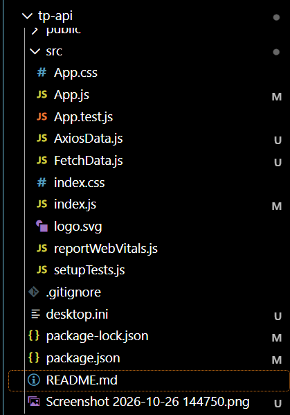

# TP 8 : Consommer une API avec Fetch et Axios dans React

## Structure du projet

## Affichage des listes

Cinq articles sur l’intelligence artificielle et dix utilisateurs fictifs. Les listes sont chargées avec Fetch et Axios depuis JSONPlaceholder. Les titres, prénoms et adresses de démonstration sont personnalisés à l’affichage.

Affichage des listes et gestion des erreurs validés